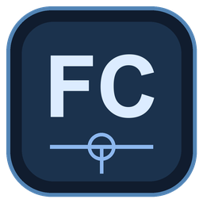
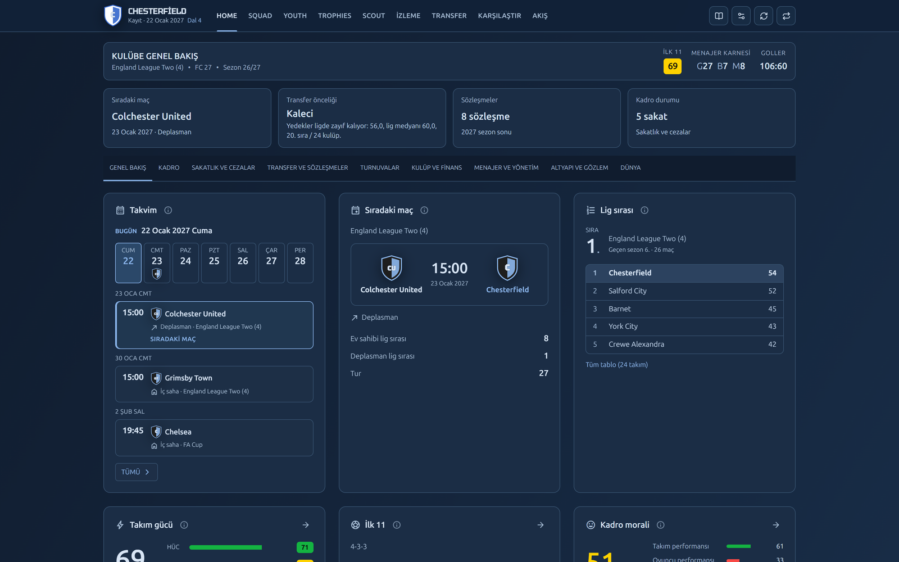
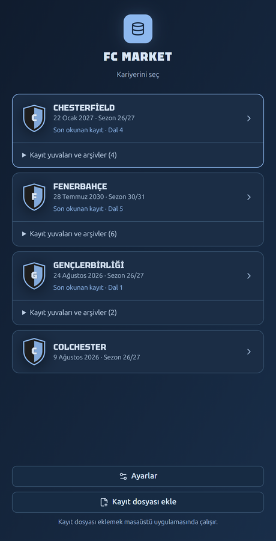
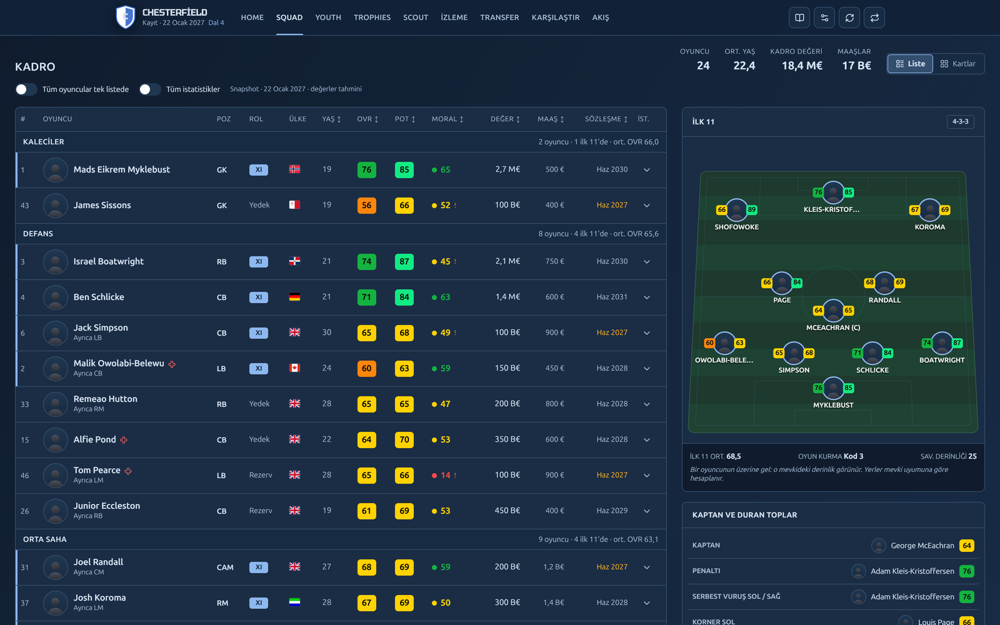
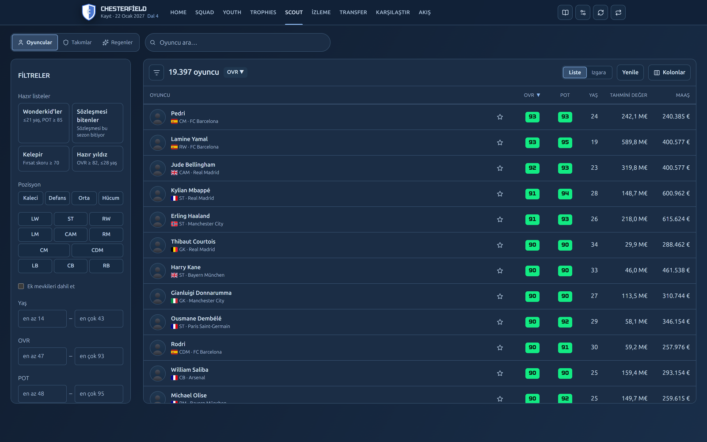
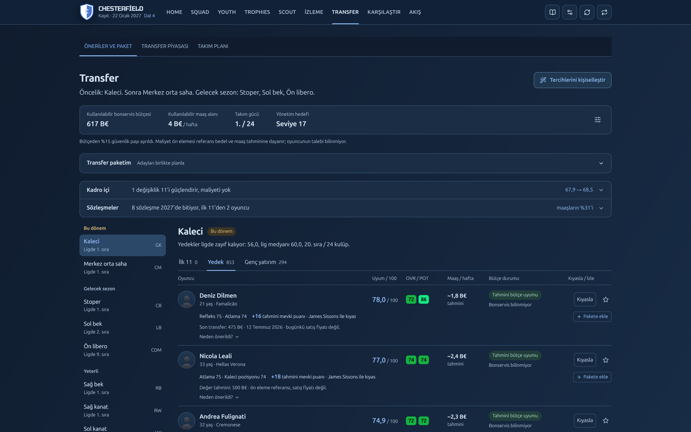
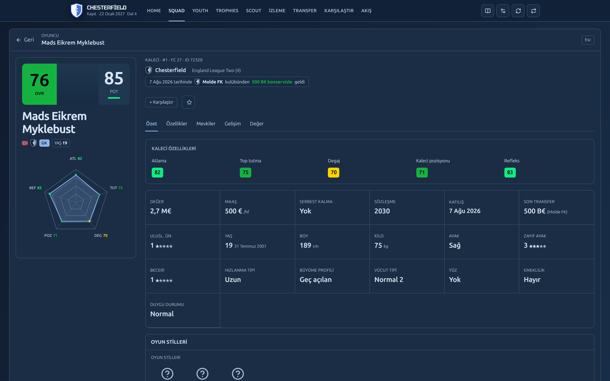

<p align="center">
  
</p>

<h1 align="center">FC Market</h1>

<p align="center">
  <b>EA SPORTS FC 27 Kariyer Modu</b> için masaüstü kariyer yardımcısı: kadron, ligin, bütçen, 19.000+ oyuncu ve
  transfer ihtiyaçların tek pencerede. <b>Oyuna ve kayıt dosyana hiçbir şey yazmaz.</b>
</p>

<p align="center">
  <a href="https://github.com/Claymore222/fc-market/releases/latest"></a>
  <a href="https://github.com/Claymore222/fc-market/releases"></a>
  
  
  <a href="LICENSE"></a>
</p>

<p align="center">
  <a href="https://github.com/Claymore222/fc-market/releases/latest/download/FcMarket-Setup.exe"><b>FcMarket-Setup.exe'yi indir</b></a>
  &nbsp;·&nbsp;
  <a href="#kurulum">Kurulum</a>
  &nbsp;·&nbsp;
  <a href="#neler-yapabilirsin">Özellikler</a>
  &nbsp;·&nbsp;
  <a href="#sık-sorulanlar">Sık sorulanlar</a>
</p>

<p align="center">
  
</p>

---

## Neler yapabilirsin

| | |
|---|---|
| **Kariyerlerin tek yerde** | Bütün kariyer kayıtların otomatik bulunur. Aynı kariyerin farklı yuvaları ve geri dönülen oturumlar ayrı **dal** olarak saklanır, geçmişin kaybolmaz. |
| **Kulübe genel bakış** | Takvim, sıradaki maç, lig tablosu, takım gücü, ilk 11, moral, sakatlık ve cezalar, sözleşmesi bitenler, finans ve yönetim hedefleri. |
| **Kadro** | Mevki gruplu liste ya da kart görünümü, ilk 11 sahası, OVR/POT, moral, değer, maaş, sözleşme; kaptan ve duran top atıcıları. |
| **Scout** | Oyundaki tüm oyuncular: hazır listeler (wonderkid, kelepir, sözleşmesi biten), mevki, yaş, OVR/POT, değer filtreleri, takımlar ve regen'ler. |
| **Oyuncu kartı** | Özellikler, mevki puanları, PlayStyle'lar, OVR/POT gelişim geçmişi, tahmini değer, transfer geçmişi. |
| **Transfer önerileri** | Kadronu ligle kıyaslayıp önceliği çıkarır (ör. "Kaleci, sonra merkez orta saha"). Bütçene uyan adayları neden önerildiğiyle listeler; transfer paketi kurabilirsin. |
| **Takım planı** | Diziliş, oyun anlayışı ve bütçe tercihine göre kadro derinliği ve gelecek sezon ihtiyaçları. |
| **Gençler, kupalar, maçlar, akış** | Altyapı ve gözlemci ağı, kazanılan kupalar, maç analizleri, iki tarih arasındaki değişimler (transferler, OVR artışları). |
| **İzleme listesi ve karşılaştırma** | Oyuncuları not ve hedef fiyatla takibe al, yan yana karşılaştır. |
| **Canlı senkron** | Oyunda kaydettiğin an veriler ~10 saniyede güncellenir. Uygulama ~1 saniyede açılır. |

## Ekran görüntüleri

<table>
  <tr>
    <td width="26%" valign="top"><br><sub>Kariyer seçimi</sub></td>
    <td valign="top"><br><sub>Kadro, ilk 11 ve duran toplar</sub></td>
  </tr>
</table>


<sub>Scout: hazır listeler, filtreler, 19.000+ oyuncu</sub>


<sub>Transfer önerileri: öncelikli mevki, bütçe uyumu, neden önerildiği</sub>


<sub>Oyuncu kartı: özellikler, sözleşme, transfer geçmişi</sub>

> Görüntülerde oyuncu yüzü, arma ve PlayStyle rozetleri yerine yer tutucular var. Bunlar EA'nın görselleri ve repoda
> bulunmuyor. Uygulamada kendi oyunundan çıkardığın görseller görünür.

## Kurulum

**Gerekenler:** Windows 10/11, EA SPORTS FC 27, FC 27 Live Editor (export ve görseller için; kayıt okuma onsuz da
çalışır). .NET ya da Python kurman **gerekmez**, ikisi de kurulumun içinde.

1. **[FcMarket-Setup.exe](https://github.com/Claymore222/fc-market/releases/latest/download/FcMarket-Setup.exe)** dosyasını indir ve çift tıkla.
2. Windows "bilgisayarınızı korudu" uyarısı gösterirse **Ek bilgi** → **Yine de çalıştır** de. Uygulama imzasız
   olduğu için bu uyarı yalnız ilk seferde çıkar. Yönetici izni sorulmaz.
3. Kurulum bitince FC Market açılır; masaüstüne ve Başlat menüsüne kısayol eklenir. İlk açılışta kariyer kayıtların
   bulunur ve listelenir.
4. **Ayarlar → Live Editor klasörü**'nü seç, **Otomatik kariyer senkronu**'nu aç.
5. Oyunu Live Editor ile başlat. Export seçtiğin sıklıkla (günlük, haftalık, aylık, 3 aylık) kendiliğinden alınır.
6. Yüz, arma ve bayraklar için **Ayarlar → Görsel script'i**'ni kur, kariyer açıkken Live Editor'de bir kez çalıştır.

FC Market kendini `%LOCALAPPDATA%\Programs\FC Market` klasörüne kurar. İndirdiğin dosyayı silebilirsin.

**Güncelleme:** Yeni sürümün `FcMarket-Setup.exe`'sini çalıştırman yeterli. FC Market açıksa kurulum onu kapatır;
verilerin (`%LOCALAPPDATA%\FcMarket`, `C:\FCExport`) korunur.

**Kaldırmak için:** Ayarlar → Uygulamalar → Yüklü uygulamalar → FC Market → Kaldır. Kariyer verilerin ve
ayarların silinmez; tamamen temizlemek istersen bu iki klasörü elle sil.

**Kurulumsuz (taşınabilir):** [FcMarket.zip](https://github.com/Claymore222/fc-market/releases/latest/download/FcMarket.zip)'i bir klasöre açıp `FcMarket.exe`'yi çalıştırabilirsin.

> [!NOTE]
> Kaynak kodun tamamı bu repoda. Her release GitHub Actions'ta bu koddan derlenir; dosyaların SHA-256 özetleri
> release sayfasında yayımlanır.

## Nasıl çalışır

```
FC 27 kariyer kaydı (CmMgrC…) ──kopyala, oku──┐
                                              ├─► fc_career.db ──► yerel API (127.0.0.1) ──► FC Market penceresi
Live Editor export'u (C:\FCExport) ───────────┘
```

- **Kayıt dosyası** oyun her kaydettiğinde kopyalanır ve kopyadan okunur. Değişmeyen kayıtlar tekrar işlenmez.
- **Live Editor export'u** kayıtta olmayan bilgileri (bütçe, ayrıntılı oyuncu alanları, görseller) tamamlar.
- İkisi tek bir yerel veritabanında birleşir. Her kayıt bir anlık görüntüdür; geçmiş ve gelişim grafikleri buradan gelir.

## Güvenlik ve gizlilik

- **Oyuna yazmaz.** Kayıt dosyaları yalnız kopyalanarak okunur; oyunun dosyasına dokunulmaz.
- **İnternete çıkmaz.** Arayüz ve API yalnız `127.0.0.1`'de çalışır, dışarıdan erişilemez. Tek istisna: bir PlayStyle
  rozeti ilk gerektiğinde EA'nın resmî adresinden indirilir ve SHA-256 ile doğrulanır. Hesap ya da kullanıcı verisi gönderilmez.
- **Verilerin sende kalır:** `%LOCALAPPDATA%\FcMarket` (kısa liste, planlar, görseller, kayıt yedekleri) ve
  `C:\FCExport` (export'lar, kariyer veritabanı). Hangi verinin ne kadar yer kapladığını **Ayarlar → Veri ve depolama**'da görürsün.

## Sık sorulanlar

**Live Editor şart mı?** Hayır. Kayıt okuma tek başına kadroyu, ligi, fikstürü ve oyuncuları getirir. Live Editor
bütçe gibi kayıtta olmayan alanları ve oyun görsellerini ekler.

**Birden fazla kariyerim var.** Hepsi açılış ekranında listelenir. Başka bir klasördeki kaydı **Kayıt dosyası ekle** ile ekleyebilirsin.

**Açılmıyor / veri gelmiyor.** Günlükler: `%LOCALAPPDATA%\FcMarket\desktop.log` ve `C:\FCExport\logs`. 5127 portu
başka bir uygulama tarafından kullanılıyorsa FC Market açılmaz.

---

## Geliştirme

Proje büyük ölçüde yapay zekâ yardımıyla yazıldı. Tasarım notları, veri sözlüğü ve kararlar `docs/` altında;
almak, değiştirmek ve geliştirmek serbest. Durum ve yol haritası: [docs/PRODUCT-ROADMAP.md](docs/PRODUCT-ROADMAP.md).

**Yığın:** ASP.NET Core 9 Minimal API (Dapper + Microsoft.Data.Sqlite) · React + Vite + TypeScript ·
WebView2 (WinForms) masaüstü kabuğu · Python 3.14 (kayıt okuyucu, görsel dönüştürücü) · Live Editor Lua script'leri.

**Windows masaüstü penceresi (WebView2):**
```powershell
powershell -ExecutionPolicy Bypass -File .\start-desktop.ps1             # gerçek veri, C:\FCExport
powershell -ExecutionPolicy Bypass -File .\start-desktop.ps1 -Sample     # örnek veri
```
Başlatıcı arayüzü ve .NET projelerini derleyip pencereyi açar. Pencere içeri aktarma ve API süreçlerini yönetir,
kapanınca durdurur. FC 27 kayıt klasörü varsa birleşik izleyiciyi (kayıt + export, 10 sn) çalıştırır.
Gerekenler: .NET 9 SDK, Python 3.14+ (Zstandard için), Node 20+, Microsoft Edge WebView2 Runtime.
Günlük: `%LOCALAPPDATA%\FcMarket\desktop.log`. 5127 portu boş olmalı.

**Tarayıcıda (masaüstü penceresi olmadan):** `.\start.ps1` (Windows) ya da `./dev.sh` (Mac/Linux, örnek veri).

### Paket ve release

```powershell
powershell -ExecutionPolicy Bypass -File .\publish.ps1 -Version 0.1.0   # artifacts\FcMarket\FcMarket.exe + zip
```
Paket çift tıkla açılır (repo gerekmez). .NET (self-contained) ve python.org'un embeddable Python'u (Pillow ile)
`app\` altına gömülür; yalnız WebView2 gerekir. Derlemek için .NET 9 SDK, Node 20+ ve Python 3.14 (pip) gerekir; kurulum dosyası için Inno Setup 6 (`winget install JRSoftware.InnoSetup`).

`vX.Y.Z` tag'i push edilince [.github/workflows/release.yml](.github/workflows/release.yml) testleri çalıştırır,
paketi bu sürümle derler; `FcMarket-Setup.exe` (Inno Setup, [installer/FcMarket.iss](installer/FcMarket.iss)) ve `FcMarket.zip`'i SHA-256 dosyalarıyla GitHub Release'e ekler. Kullanıcı verisi
`%LOCALAPPDATA%\FcMarket` altında (app.db, `images\`, kayıt yedekleri, `settings.json`) ve yeni paket açıldığında
korunur. `settings.json` (isteğe bağlı):
```json
{ "exportDir": "C:\\FCExport", "python": "C:\\...\\python.exe" }
```

### Veri akışı

| Kaynak | Ne zaman | Araç |
|---|---|---|
| Live Editor export'u | Ay başı tam, her oyun günü hafif (kadro + lig + izleme listesi), elle | `exporter/lua/fc_export.lua` (Live Editor Lua Engine'de bir kez çalıştırılır, sonra kendiliğinden) |
| Kariyer kaydı (`CmMgrC*`) | Oyun her kaydettiğinde | `python -m tools.saveimport watch "%LOCALAPPDATA%\EA SPORTS FC 27\settings" --export-dir C:\FCExport --db C:\FCExport\fc_career.db` |
| Yüz, arma, bayrak | Bir kez (yeni oyuncular için tekrar) | `exporter/lua/fc_assets.lua` → `python -m tools.assets convert C:\FCExport\assets` |

İkisi tek veritabanında birleşir: aynı gün kayıt tabloları kayıttan, bütçe gibi bellek alanları export'tan; günlük
export son tam snapshot'ın üzerine bindirilir. Ayrıntı: [docs/save-import.md](docs/save-import.md).

### Testler
```bash
dotnet test backend/FcMarket.Tests
python -m unittest discover -s tools/saveimport/tests
python -m unittest discover -s tools/assets/tests
python exporter/tools/test_importer.py
npm --prefix frontend run test:e2e        # Microsoft Edge gerekir; gerçek kayıtlara dokunmaz
```

### Yapı
```
exporter/lua/             Live Editor script'leri: fc_export (export), fc_assets (görseller), mods/ (Faz 5 denemeleri)
exporter/tools/           eski export importer'ı ve örnek veri üretici
tools/saveimport/         kayıt okuyucu (T3DB + kariyer blokları), birleşik içeri aktarma ve izleyici
tools/assets/             DDS → PNG (faces/, crests/, flags/)
backend/FcMarket.Api/     ASP.NET Core 9 Minimal API (Dapper + Microsoft.Data.Sqlite), salt-okunur
frontend/                 React + Vite + TypeScript
desktop/                  WebView2 masaüstü kabuğu
installer/                Inno Setup kurulum script'i (FcMarket-Setup.exe)
config/field-map.json     kanonik alan → ham oyun alanı eşlemesi (+ etiketler)
config/saveimport/        kayıt meta verisi (MIT kaynaklı, bkz. README)
docs/                     PRODUCT-ROADMAP, data-dictionary, save-import, career-mods
```
Git dışı yerel veriler: `faces/`, `crests/`, `flags/`, `app.db`, `scratch/`, `sample_export/`.

### Ayarlar
- **Veri yolu:** `FC_CAREER_DB` ya da `appsettings.json` → `Paths:FcCareerDb`. Göreli yollar repo köküne göre.
- **Export klasörü** (izleme listesi `watchlist.txt` buraya yazılır): `FC_EXPORT_DIR`, varsayılan veritabanının klasörü.
- **Alan eşlemesi:** `config/field-map.json`; değişince backend yeniden yükler, eksik alanlar `/api/health`'te.
- **Değer ve fırsat formülleri:** `appsettings.json` → `Valuation`, `Opportunity`.
- **Görsel klasörleri:** `FC_FACES_DIR`, `FC_CRESTS_DIR`, `FC_FLAGS_DIR`, `FC_PLAYSTYLES_DIR` (varsayılan repo kökü).
- **LAN erişimi:** varsayılan yalnız `127.0.0.1`. `Server__Host=0.0.0.0` kimlik doğrulamasız açar; yalnız güvenilir ağda.

### API
| Yol | Açıklama |
|---|---|
| `GET /api/health` | DB durumu, son snapshot, field-map uyarıları |
| `GET /api/saves`, `/api/snapshots` | Kariyerler, dallar, snapshot'lar |
| `GET /api/club`, `/api/teams` | Kulüp görünümü (kadro, tablo, fikstür, kayıt verileri), takım veritabanı |
| `GET /api/filters/options`, `/api/players` | Scout filtreleri; filtre, çoklu sıralama, sayfalama |
| `GET /api/players/{id}`, `/history` | Oyuncu detayı, OVR/POT geçmişi (günlük noktalar dahil) |
| `GET /api/players/{id}/face`, `/api/teams/{id}/crest`, `/api/nations/{id}/flag` | Yerel görseller (yoksa 404) |
| `GET /api/playstyles/{slug}` | PlayStyle rozeti (ilk istekte EA'dan indirilir, SHA-256 doğrulanır) |
| `GET /api/settings/storage` | Veri alanlarının konumu ve boyutu |
| `GET/POST/PUT/DELETE /api/shortlist` | İzleme listesi (app.db) |
| `GET /api/feed` | Snapshot'lar arası değişim akışı |

---

<sub>Lisans: [Apache-2.0](LICENSE). FC Market bağımsız, hayran yapımı bir araçtır; Electronic Arts ya da EA SPORTS ile bağlantılı değildir ve onlar
tarafından desteklenmez. EA SPORTS FC ve ilgili adlar Electronic Arts Inc.'in ticari markalarıdır. Oyun görselleri
repoda ve pakette yer almaz.</sub>
